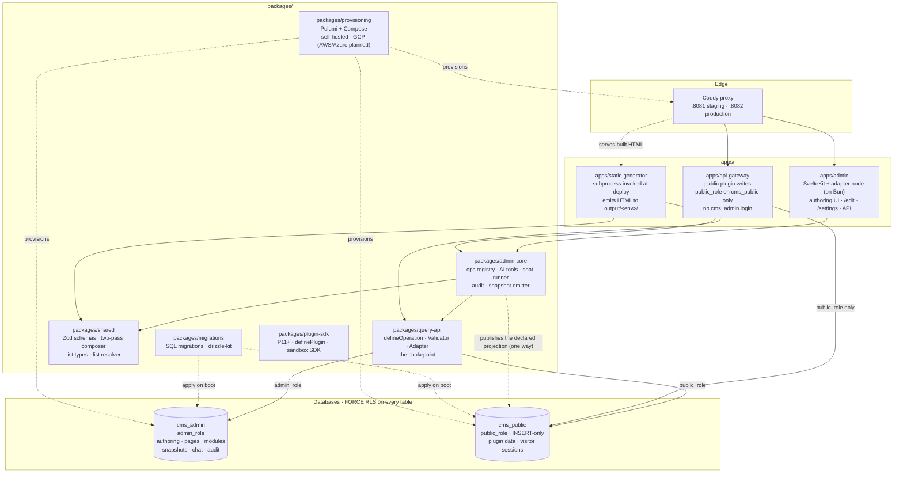
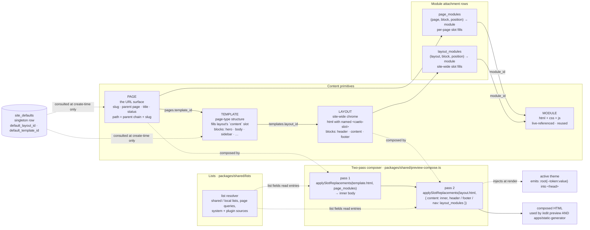
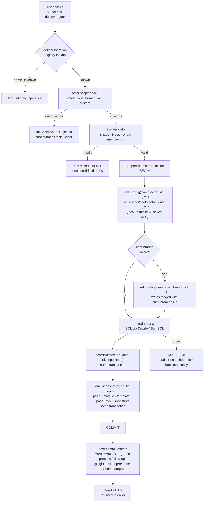
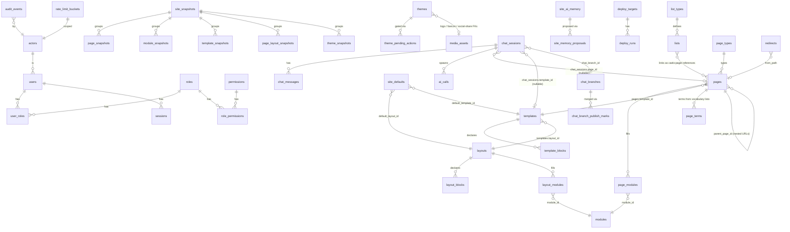

# Architecture

This is the deep-dive companion to [`CLAUDE.md`](./CLAUDE.md). CLAUDE.md is the engineering-rules file (read first, kept short). This file answers *"how does Caelo fit together?"* — broken into four focused diagrams plus a guide to where things live in the repo.

For the *why* behind every choice (RLS, two databases, snapshots, no-fallbacks, etc.) see [`CMS_REQUIREMENTS.md`](./CMS_REQUIREMENTS.md). End-user documentation (install, editing, plugins, MCP) lives in the CMS at [caelo-cms.com/docs](https://caelo-cms.com/docs/), built in Caelo itself; the developer docs are indexed in [`docs/README.md`](./docs/README.md) (CLAUDE.md §10).

---

## 1. System overview — what runs where

**Key invariants** (see [CLAUDE.md §2](./CLAUDE.md#2-non-negotiable-invariants)):

- **The public side has no path to cms_admin** (#635). The API gateway connects to cms_public only, as `public_role`; it holds no cms_admin login of any role and refuses to boot when its env offers any database access besides `PUBLIC_DATABASE_URL`. Its own state (request log, rate-limit buckets, captcha challenges, plugin op events) lives in cms_public. What it needs from authoring state (its settings, the staging gate, rate limits, the active-plugin registry, each plugin's declared `visitorProjection`, approved comments) the admin **publishes** into cms_public, one way, kept current by an outbox the source tables' triggers write in the same transaction (`packages/migrations/src/public-projection.ts`). Its plugin host is dispatch-only and reads only that projection (`packages/plugin-host/src/published-state.ts`). Everything the admin reads back from cms_public is **untrusted input**: Zod-validated at the boundary, rendered as text, never an instruction or a privileged trigger on its own. Details and the guardrails that keep it so: [docs/dev/public-admin-boundary.md](./docs/dev/public-admin-boundary.md). Every role has its own password secret, so the gateway's service account cannot read admin_role's.
- RLS is `FORCE`d on every table in both databases — role isolation alone is not enough.
- The static generator runs as a subprocess at deploy time. It is not a long-running service. It has no plugin host of its own: every plugin answer a build needs (data lists, head contributions, public URLs, content variants, withheld modules, `staticRender`, client assets) is a call back over its stdio to the admin's plugin host (`packages/plugin-host/src/build-services.ts`, #605), so the published site gets what the preview shows.

---

## 2. Content composition — how a page becomes HTML

Four primitives wired top-down. A **layout** owns site-wide chrome; a **template** defines a page-type's blocks; a **page** binds to one template and references modules; **modules** are the leaf content units. Composition is two-pass: template fills first, then the layout wraps it.

**No-fallback rule** (see [CLAUDE.md §2](./CLAUDE.md#2-non-negotiable-invariants)): missing layout `content` slot, an unbound or missing list (`list-unbound` / `list-missing` markers), missing template/layout where required → `ComposeError` / structured `HandlerError`. Never silent recovery. `site_defaults` is a *create-time* resolver, NOT a render-time fallback.

**One `add_module` tool with three targets, picked by intent:**

| user says… | tool | blast radius |
|---|---|---|
| "add a CTA on this page" | `add_module` (`target: 'page'`) | one page |
| "add a hero on every blog post" | `add_module` (`target: 'template'`) | all pages on the template |
| "add a footer on every page" | `add_module` (`target: 'layout'`) | all pages on the layout |
| "move the hero to the header" | `move_module` (`toBlockName`; `fromBlockName` + `fromPosition` when the module is placed twice+) | same page, cross-block; one placement, its content moves with it |
| "show testimonials before gallery" | `move_module` (no `toBlockName`) | same page, same block |
| "duplicate this page" | `duplicate_page` | modules carry by reference |
| "switch this page to landing-tpl" | `repoint_page_template` | modules migrate; orphan disposition required |
| "add Careers under Company" | `patch_list_items_many` | the shared menu list; every module bound to it |
| "make the primary brighter" | `set_theme_tokens` | the active theme |

Mutations on layouts and site_defaults are Owner-only (`actorScope: ["human","system"]`); AI calls return `ActorScopeRejected` and the chat surfaces a permission message instead of retrying.

---

## 3. Write path — from user click to Postgres row

Every mutation — form action, AI tool call, deploy trigger — traverses the same chain. The Validator is the chokepoint; the adapter binds the actor identity to the transaction so RLS policies see the right scope.

**Branch-aware writes.** Every chat writes to a branch, not to main. By default that is the site's one shared draft (`site_draft`, `packages/admin-core/src/draft.ts`): all chats bind to it and see each other's unstaged changes. An experiment or a site migration moves its chat onto an isolated branch first (`start_isolated_branch`). Snapshots emitted from a chat are tagged with the branch's `chat_branch_id` and stay pending until a Stage merges the selected chats' snapshots into main and rebuilds staging (`packages/admin-core/src/stage/stage-chats.ts`). Publish live — promoting staging to production — is a separate human click. Two chats editing the same entity do not block each other: the later write takes over the earlier chat's lock and its unstaged change (`locks.ts`, `lock-takeover.ts`), and both chats are told. A page's SEO fields belong to the page: they ride its page snapshot (`state.seo`), so an SEO edit in a chat is a pending page change like a title edit, merged into `pages_seo` by the Stage (`packages/admin-core/src/seo/page-seo.ts`).

**Step-wise ops hold no transaction.** An op whose body waits on foreign work for minutes — a Stage runs the generator subprocess and the provider upload — is defined with `defineStepwiseOperation` (`packages/query-api/src/operation.ts`, #1211). `execute()` checks its actor scope and input like any op, then runs its body without opening a transaction; every database step is an op of its own, committed on its own. Holding one transaction across that work pinned a pooled connection while the run's own progress writes took more from the same pool — the pool deadlock of #1209. `deploy.trigger` (Stage, `packages/admin-core/src/ops/deploy-trigger.ts`), `deploy.promote` (Publish live, `ops/deploy-promote.ts`, #1225) and `deploy.build_plugin_data` (`plugin-data/build.ts`, #1220) have this shape: each run row carries a lease renewed by a heartbeat (a run whose process died is marked failed once its lease lapses), and the publish order is a lease row in `deploy_leases` instead of a transaction-scoped advisory lock — `staging-publication` for what the staging host serves (`deploy/staging-publication-lock.ts`), `live-release` for every release on the live channel (`deploy/live-release-lock.ts`). A run claims a lease and waits outside any transaction while it is held; short transactions (rollback, the redirect sync, the CDN purge, the preview keep-alive) lock the row only while no run holds it. Right before an irreversible provider step a run proves it still holds its leases (one renewal, the fence). A caller that stops the run kills its generator, and the run ends failed with every lease released. An approved card or "publish anyway" runs Publish live as an op of its own: the proposal is claimed in one short step (`claimed_by_run_id`, against a double click) and marked applied in another.

**Post-commit effects.** A write whose twin lives in the running process (stopping a plugin whose grant was revoked, resuming a re-enabled one, removing an uninstalled one) registers that twin with `afterCommit(tx, effect)` (`packages/query-api/src/post-commit.ts`). The adapter runs it only after the COMMIT and drops it on rollback, so process state never runs ahead of the database (#585). A failing effect is loud: an error log, a failed `<op>.post_commit` audit row, and an error result that says the change itself is saved.

**One connection per call chain** (#1210). A transaction must never wait for a second connection of its own pool: with every pooled connection held that way, nothing is ever released and the admin hangs while the database idles (production, 2026-10-28). The adapter marks each transaction's async call chain (`AsyncLocalStorage`, `packages/query-api/src/pool-guard.ts`) and throws `NestedPoolCheckoutError` when that chain enters the same pool again — another op through `execute()`, `withAdminTransaction`, the raw pool handles. Compose ops inside a transaction with `op.handler(ctx, input, tx)`. An op that orchestrates other ops around long foreign work (a chat turn, a tool call, downloads) is **detached** (`transaction: "none"`): it holds no transaction, runs each step as its own op or as `tx.transaction(fn)` (one short transaction of its own), and never sits idle in a transaction while the model or the network works. Every checkout waits at most 10 s for a free connection (`PoolAcquireTimeoutError`), and the databases end a statement after 60 s, a lock wait after 15 s and a transaction idle for 60 s (migration 0392). The guard keeps two allowlists (#1220): holders that still nest, each with the FIXME issue that removes it, and holders whose one transaction legitimately outlasts the 0392 timeouts (a static build runs in one transaction for as long as it takes) — those run without the timeouts but may not nest. A cross-process lock that has to outlive a transaction is a committed lease row, not a transaction held open around foreign work: `deploy_leases` (Stage), `plugin_activation_leases` (a plugin's `onActivate`, migration 0403).

**Read operations hold no transaction.** A read whose work is mostly not database work — the editor preview (`pages.render_preview`) asks plugins, resolves fonts and composes the page — is a `defineReadOperation` (`packages/query-api/src/operation.ts`, #1212): it reads in short transactions (`reads.read(tx => …)`, each under the caller's identity, after one branch-visibility check) and holds no pooled connection in between. A transactional op that awaited a plugin held its connection while every plugin storage access took another from the same pool, and N such ops on a pool of N deadlocked for good (#1209). The preview's whole-site reads come from one site view per branch (`packages/admin-core/src/site-view.ts`), cached in memory and re-read only when the site-view generation moves: a counter that a deferred trigger bumps at the commit of every change to the tables the view reads (cms_admin migration 0394), whoever made it.

**Static-generator parity.** Both the admin's `/edit` preview AND `apps/static-generator` (deploy) call `composePageWithLayout` from `packages/shared/preview-compose.ts`. Same input → byte-identical output. There is no separate "production renderer". Plugin input reaches both through the same resolvers: the preview calls the plugin host in-process, the generator subprocess calls it through the admin (`BuildPluginServices`, #605). One deliberate divergence after composition: the static build minifies the composer's own inline `<style data-source=…>` / `<script data-source="modules">` bodies as its last pass (`apps/static-generator/src/minify-pass.ts`, #158), so the preview stays readable and the deployed page ships minified. Markup and every other byte are unchanged by that pass.

**Build memory is flat in the site's size** (#1271). The generator composes, rewrites and writes pages in batches of 200, and keeps a small record per page for the steps that need every page (sitemap, manifests, parity digests). It never reads a media or font file. Files are named by the digests stored with each `media_variants` row (migration 0443, `media.rebuild_digests`), and the build references them in `_caelo-asset-references.json`. The uploading publishers deliver only what the provider lacks, streamed from the store. Self-hosted hard-links them into the build. Details: [`docs/dev/build-memory.md`](./docs/dev/build-memory.md).

**Page-wide CSS/JS bundles.** Every module's CSS joins one `<style data-source="modules">` and its JS one `<script data-source="modules">` per page, each module once however often it is placed (#158). Module CSS is scoped by convention under the module's root class; the authoring tools flag unscoped selectors (`packages/shared/src/css-scope-scan.ts`). Accordions, tabs, carousels and the nav menu's mobile toggle come from a vetted interaction kit (`packages/shared/src/interactions.ts`, #160): markup carrying `data-caelo-ui="<id>"` pulls that interaction's functional CSS and delegated JS into the page once.

---

## 4. Data model — what's in `cms_admin`

Foreign keys are shown only where they cross domain boundaries. Every box has FORCE RLS.

**Domain boundaries.**

| Domain | Tables (representative) | Notes |
|---|---|---|
| **Auth** | `users`, `sessions`, `actors`, `roles`, `permissions`, `user_roles`, `role_permissions` | Argon2id passwords. Sessions hold a CSRF token consumed by every form action. |
| **Content** | `layouts`, `layout_blocks`, `layout_modules`, `templates`, `template_blocks`, `pages`, `page_modules`, `modules` | Two-pass composer: layout wraps template; both have block/module attachment rows. |
| **Snapshots** | `site_snapshots`, `page_snapshots`, `module_snapshots`, `template_snapshots`, `page_layout_snapshots`, `chat_branch_publish_marks` | Every write emits a snapshot. Reverting `site_snapshots` restores the full set atomically. |
| **Chat** | `chat_sessions`, `chat_branches`, `site_draft`, `chat_messages`, `ai_calls`, `site_ai_memory`, `site_memory_proposals` | Sessions bind to the shared draft, or to an isolated branch for experiments and migrations. AI memory proposals queue for Owner review. |
| **Deploy** | `deploy_targets`, `deploy_runs` | `deploy_runs.progress jsonb` updated by the static generator subprocess. |
| **Lists** (epic #1107) | `list_types`, `lists`, `page_types`, `page_terms` | Schema-free lists defined by list types; page types with properties and vocabularies. See [`docs/lists.md`](./docs/lists.md). |
| **Sideband** | `redirects`, `site_defaults`, `audit_events`, `rate_limit_buckets`, `user_preferences` | `site_defaults` is a singleton row. |
| **Themes** (v0.11.0, #45) | `themes`, `theme_snapshots`, `theme_pending_actions` | DTCG-shaped jsonb `tokens` (color / dimension / typography composite / shadow composite / motion / breakpoint, plus DTCG aliasing). Exactly one `is_active=true` row enforced by partial unique index. Four media FKs for logo / logo-dark / favicon / social-share. Create / activate / delete go through the §11.A propose/execute gate (`theme_pending_actions`). The renderer reads the active theme via `ComposeInput.theme` and emits Tailwind 4-namespaced CSS vars under `<style data-source="theme">`. Zod source of truth: `packages/shared/src/themes.ts`. |

**Snapshot semantics.** A snapshot is a content-addressed copy of an entity at a point in time, grouped under a `site_snapshots` row tagged with the originating chat branch (or `NULL` for system / direct-admin writes). Reverting walks the group and restores every member in one transaction. Chat-keyed Undo (the primary history surface) drops the current chat's pending snapshots, plus any later pending snapshot built on them (`draft.ts`); the other chats affected are reported before the undo is confirmed.

---

## Repo guide — where things live

| Path | What lives here |
|---|---|
| `apps/admin/` | SvelteKit admin app + every authenticated route (`/edit`, `/content/*`, `/settings/*`). |
| `apps/static-generator/` | Subprocess invoked by `deploy.trigger`; reads composed pages + emits HTML to `output/<env>/`. |
| `apps/api-gateway/` | Public `/api/*` endpoints for plugin writes (forms, comments, ratings, newsletter) with rate limits, proof-of-work captcha and honeypots; connects to cms_public only, as `public_role`, and holds no cms_admin login (#635). |
| `packages/admin-core/` | Ops registry + AI tool dispatch + chat-runner + audit + snapshot emitter. The orchestrator. Its two pieces of work that leave the admin process on GCP, each as a short-lived Cloud Run job running the admin image: the quality audit's Lighthouse runs (`quality/`, #875) and every server-side browser render (`capture/`, [docs/dev/capture-job.md](./docs/dev/capture-job.md), #1217). |
| `packages/query-api/` | `defineOperation`, the Validator, the Database Adapter. Every DB call goes through here. |
| `packages/shared/` | Zod schemas, the two-pass composer, the slot scanner, list types and the list resolver. Shared between admin and static-gen. |
| `packages/migrations/` | SQL migrations for both `cms_admin` and `cms_public`; applied in order at boot. |
| `packages/plugin-sdk/` | P11+ — `definePlugin`, `defineComponent`, the Deno-sandbox SDK injected into plugin code. |
| `packages/provisioning/` | The `cms-provision` CLI: self-hosted Docker Compose and the GCP stacks (`gcp`, `gcp-firebase`) via Pulumi, plus lifecycle commands (upgrade, backup, status, …). AWS and Azure stacks exist but their install wizard is not implemented yet. |

---

*This document is hand-edited. A future `apps/admin/scripts/generate-architecture-doc.ts` could regenerate the diagrams from the ops registry + migration files; see the deferred items in the master plan.*

### External installation boundary

External packages are immutable `(manifest, source)` artifacts identified by SHA-256. `plugin_installation_versions` holds pending updates independently of `plugins`, and `plugin_capability_grants` records each authenticated `plugins.install` decision. Approval records receipts; host preparation then finalizes the exact reviewed state. An old source keeps running during preparation. Private storage and chat-tool brokers run through Deno RPC and the same SDK storage implementation as bundled plugins. Runtime receipt checks and a shared registry-row lock serialize storage commits against revocation. Visitor/render invocations never acquire private author handles. Further capability brokers are a separate rollout and fail closed until implemented.
